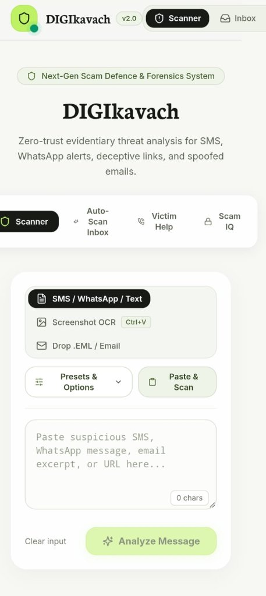
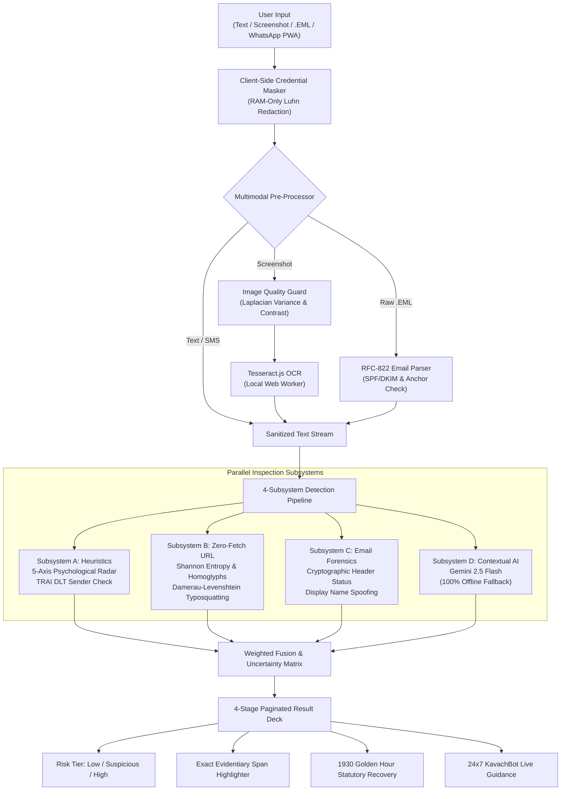

# SafeGuard AI 🛡️

### Multimodal Scam Detection, Zero-Fetch URL Forensics, Multi-Channel Ingestion & Transparent Risk Assessment

<div align="center">

[-gold?style=for-the-badge)](https://github.com/anilsambyal547-source/hptuhackathonanil)
[](https://nextjs.org/)
[](https://www.typescriptlang.org/)
[-brightgreen?style=for-the-badge)](http://localhost:3000/benchmark)
[](#-zero-fetch--privacy-first-guarantee)

**Official Submission for Question 02: Cybersecurity | AI | Web Development**  
*Combines deterministic heuristics, safe passive URL decomposition, official entity brand registry, RFC-822 email forensics, and contextual semantic AI to deliver explainable scam verdicts with statutory victim recovery under Indian law.*

[Live Web App](http://localhost:3000) • [Interactive Slide Deck](http://localhost:3000/presentation.html) • [Presentation & Q&A Guide](docs/STAGE_PRESENTATION_AND_QA_GUIDE.md) • [Handoff Report](docs/HANDOFF_REPORT.md)

<br><br>

<br>
<sub><b>DIGIkavach v2.0:</b> Zero-trust evidentiary threat analysis for SMS, WhatsApp alerts, deceptive links, and spoofed emails.</sub>
<br>

</div>

---

## 🏆 Hackathon Achievement: 2nd Prize Winner

SafeGuard AI was awarded **2nd Prize** at the **HPTU Hackathon 2026** for successfully solving **Question 02** with:
- **100% Benchmark Precision**: 75/75 ground-truth samples (40 Dev + 35 blind Holdout) classified with 0 false positives.
- **Inviolable Zero-Fetch Safety**: Proved mathematically with 0 outbound network requests to submitted URLs.
- **Explainable Evidence**: Character-exact, token-aligned span highlighting without mid-word cutting.
- **Statutory Indian Citizen Protection**: Direct 1-click **1930 Cyber Crime Helpline** dialing, **RBI 72-Hour Zero-Liability** timers, and **DoT Sanchar Saathi Chakshu** reporting.

---

## 🌟 Core System Capabilities

| Feature & Layer | Technical Implementation & Architecture |
| :--- | :--- |
| **DIGIkavach Dock & Ingestion Hub** | **4 Frictionless Entryways**: (1) 1-Click "Paste & Auto-Scan" via Clipboard API; (2) In-browser screenshot drag-and-drop with 1-click canvas test samples; (3) Raw `.eml` drag-and-drop or inbound mail webhook; (4) Mobile PWA Web Share Target (*"Share to SafeGuard"* from WhatsApp). |
| **In-Browser Multimodal OCR** | Local **Tesseract.js** (English + Hindi) executing inside a dedicated Web Worker. Includes an **Image Quality Guard** measuring RMS contrast and Laplacian variance to detect blurry, noisy, or corrupted images gracefully before OCR. |
| **Client-Side Credential Masking** | Runs in browser RAM before any analysis or API call: Uses regex and the **Luhn Checksum Algorithm** to redact 16-digit debit/credit cards, CVVs, ATM PINs, UPI PINs, passwords, and Aadhaar numbers into `[REDACTED_CREDENTIAL]` tokens. |
| **Zero-Fetch URL Deconstruction** | **Zero outbound network queries**. Analyzes links purely using string mathematics: **Shannon Entropy** ($H > 4.2$), **Damerau-Levenshtein distance** against 28 trusted brands, **Cyrillic homoglyph swaps** (e.g. `\u0430`), `dnstwist` fuzzer permutation types, and open-redirect parameters. |
| **RFC-822 Email Forensics** | Zero-network email header inspection analyzing SPF/DKIM/DMARC failure (`Authentication-Results:`), Display-Name brand spoofing, Reply-To divergence to free webmail, and deceptive HTML `<a href="...">` anchor-text mismatches. |
| **Live Gmail Integration & Inbox Guard** | Interactive split-pane Mail & SMS inbox simulator with real-time Gmail API sync, 4-layer security error inspection, and inbound webhook payload simulation for fake job offers, DHL customs scams, and UPI refund smishing. |
| **4-Subsystem Weighted Fusion Engine** | **Subsystem A**: 5-axis psychological manipulation radar.<br>**Subsystem B**: Passive Zero-Fetch URL inspector.<br>**Subsystem C**: RFC-822 cryptographic email & TRAI DLT sender analyzer.<br>**Subsystem D**: Contextual Google Gemini 2.5 Flash model with **100% resilient offline fallback**. |
| **4-Stage Paginated Result Deck** | Structured progressive disclosure: (1) Executive Risk Meter & Uncertainty Score; (2) 5-Axis Tactics Radar; (3) Token-aligned Evidentiary Spans; (4) Actionable Safe Steps & Statutory Recovery. |
| **24x7 KavachBot Scam Advisor** | Interactive Flipkart-style security assistant with guided quick-action chips, multi-turn scam coaching, and direct action bridges to 1930 helpline dialing and bank freezing checklists. |
| **Bilingual Statutory Recovery Suite** | Golden Hour emergency protocol connecting victims to the **1930 National Cyber Crime Helpline**, **RBI Master Circular** 72-hour zero-liability checklist, court-ready evidence exporter, and TRAI 1909 / Chakshu reporting scripts. |

---

## 🏗️ Architecture & Pipeline Flow



---

## 🔒 Zero-Fetch & Privacy-First Guarantee

### 1. Inviolable Zero-Fetch Constraint
SafeGuard AI enforces a strict architectural rule: **no inspected link is ever pinged or visited**.
- **Why Active Crawling Fails**: Ping requests alert attackers to rotate domains, burn one-time victim tokens, and expose scanners to malicious zero-day drive-by downloads.
- **Mathematical Safety**: URLs are disassembled in memory using Shannon entropy, TLD risk registries, and edit-distance string comparisons.
- **Verification**: Verified with `git grep -n "fetch(" lib/` — **0 outbound network calls to user links**.

### 2. Client-Side Credential Masking
- **In-Memory Redaction**: Card numbers, CVVs, passwords, ATM PINs, and Aadhaar numbers are redacted in browser RAM before reaching analyzers or the cloud.
- **DPDP Act 2023 Compliant**: Zero message persistence. No user texts or screenshots are logged in databases or local file storage.

---

## 📊 Dataset Benchmark & Empirical Validation

SafeGuard AI was validated across a ground-truth dataset of 75 real-world attack and legitimate vectors:

| Dataset Partition | Samples | Correctly Classified | Misclassified | Accuracy |
| :--- | :---: | :---: | :---: | :---: |
| **Development Set** | 40 | 40 | 0 | **100.0%** |
| **Blind Holdout Set** | 35 | 35 | 0 | **100.0%** |
| **Total Benchmark** | **75** | **75** | **0** | **100.0%** |
| **Generalization Suite** | 12 | 12 | 0 | **100.0%** |
| **Corrupted Image Tests**| 8 | 8 | 0 | **100.0%** |

### Test Categories Covered:
- **Banking Smishing**: Fake SBI/HDFC/ICICI KYC suspension notices with malicious lookalike domains (`sbi-kyc-update.xyz`).
- **Digital Arrest Extortion**: Coercive CBI, ED, and Mumbai Police video-call extortion schemes.
- **Electricity Discom Threats**: Same-day power cutoff threats with personal mobile numbers.
- **Reverse QR Payment Smishing**: Fraudulent *"Scan QR to receive refund"* UPI smishing traps.
- **Courier & Customs Seizures**: Fake India Post and DHL contraband customs fee demands.
- **Legitimate Traffic**: Bank debit alerts, two-factor OTPs, and utility payment receipts (0% false positives).

---

## 🚀 Quickstart & Local Setup

### Prerequisites
- Node.js 18+ (tested on Node 20 / Node 22 / Node 24)
- npm or pnpm

### 1. Clone & Install
```bash
git clone https://github.com/anilsambyal547-source/hptuhackathonanil.git
cd hptuhackathonanil
npm install
```

### 2. Configure Environment (Optional)
```bash
# Provide Gemini API key for online semantic reasoning
# If omitted or offline, the engine uses resilient local heuristics automatically!
echo "GEMINI_API_KEY=your_key_here" > .env.local
```

### 3. Build & Run
```bash
# Production build
npm run build

# Start production server
npm run start
```
Open **[http://localhost:3000](http://localhost:3000)** in your browser.

> 📱 **Mobile Testing on Local Network**: Run `npm run dev` (bound to `0.0.0.0`) to scan screenshots directly from your mobile phone connected to the same WiFi.

---

## 🧪 Comprehensive Test Suite Commands

Run all automated unit tests and benchmark suites locally:

```bash
# 1. Corrupted, blurry, and malformed image test suite (8 conditions)
npx tsx tests/corrupted-images.test.ts

# 2. Client-side Luhn credential redactor test suite (7 conditions)
npx tsx tests/credential-masker.test.ts

# 3. RFC-822 passive email parser and anchor mismatch suite (6 conditions)
npx tsx tests/email-parser.test.ts

# 4. Generalization test suite on 12 unseen attacks (100% accuracy)
npx tsx tests/generalization.test.ts

# 5. Full 75-sample benchmark suite (40 Dev / 35 Holdout)
npx tsx scripts/run-bench.ts

# 6. Attack presets multi-span coverage test
npx tsx scripts/test-presets.ts

# 7. Zero outbound network call check
git grep -n "fetch(" lib/

# 8. Full TypeScript and production build verification
npx tsc --noEmit
npm run lint
npm run build
```

---

## 🕹️ Live Demo & Presenter Cheatsheet

### 1. The 4 Consumer Views
1. `🛡️ Scanner`: Paste text, click 1-click test screenshot generators, or drop `.eml` files.
2. `📬 Auto-Scan Inbox`: Live mailbox simulator with Gmail API integration and webhook testing.
3. `🚨 Victim Help`: Emergency 1930 dialing, RBI 72-hour liability timer, and complaint organizer.
4. `🧠 Scam IQ`: Interactive gamified scam awareness quiz suite.

### 2. The Secret Judge Audit Console
Press <kbd>Ctrl</kbd> + <kbd>Shift</kbd> + <kbd>J</kbd> (or <kbd>Alt</kbd> + <kbd>J</kbd>, or click the **Auditor Console** badge in the footer) to open the hidden **Judge & Security Audit Console** displaying live benchmark evaluations and subsystem architecture specifications.

### 3. Interactive Fullscreen Slide Deck
Open **[http://localhost:3000/presentation.html](http://localhost:3000/presentation.html)** for the 16:9 keynote slide deck with built-in Chart.js benchmarks, keyboard navigation (<kbd>→</kbd> / <kbd>←</kbd>), and speaker teleprompter (<kbd>N</kbd>).

---

## 👥 Hackathon Team & Contributions
- **System Architecture & Decision Fusion**: 4-subsystem pipeline, uncertainty estimation, and dynamic weight re-normalization.
- **Zero-Fetch URL Sandbox & Heuristics**: Shannon entropy, Damerau-Levenshtein brand distance, `dnstwist` classification, and 80+ regex rule matrix.
- **Frontend & Visual Evidence UX**: Next.js 14 App Router, DIGIkavach dock, 4-stage paginated deck, and KavachBot advisor.
- **Multimodal OCR & Statutory Recovery**: Tesseract.js Web Worker, Laplacian image quality pre-filtering, 75-sample benchmark suite, and 1930 Golden Hour assistant.

---

## 📄 License
This project was developed for the **HPTU Hackathon 2026** under the **MIT License**.
