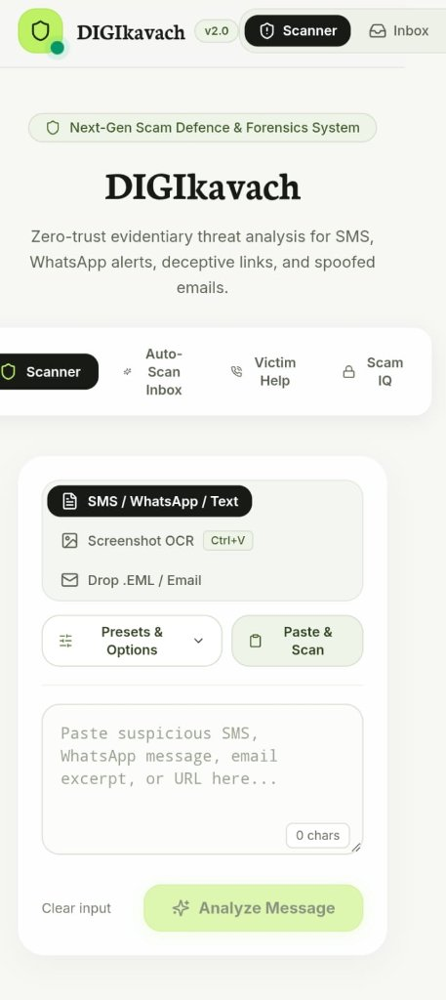
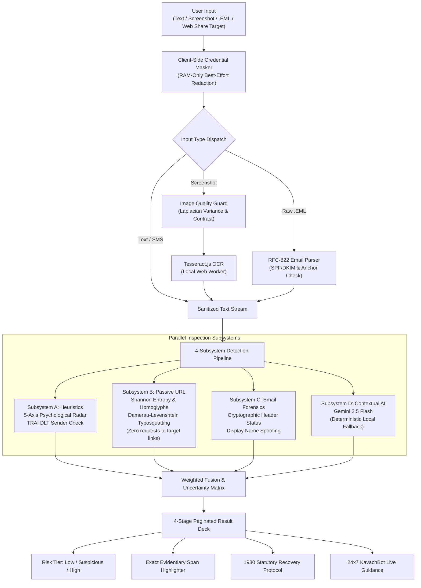

# DIGIkavach 🛡️

### Multimodal Scam Detection, Passive URL Forensics, Multi-Channel Ingestion & Transparent Risk Assessment

<div align="center">

[-gold?style=for-the-badge)](https://github.com/anilsambyal547-source/hptuhackathonanil)
[](https://nextjs.org/)
[](https://www.typescriptlang.org/)
[-brightgreen?style=for-the-badge)](#-benchmark-dataset--evaluation-methodology)
[-emerald?style=for-the-badge)](#-network-audit--link-inspection-guarantee)

**Official Submission for Question 02: Cybersecurity | AI | Web Development**  
*Combines deterministic heuristics, passive string-based URL decomposition, trusted entity brand registry, RFC-822 email forensics, and contextual semantic AI to deliver explainable scam verdicts with statutory victim recovery under Indian law.*

[Interactive Slide Deck](/presentation.html) • [Presentation & Q&A Guide](docs/STAGE_PRESENTATION_AND_QA_GUIDE.md) • [Handoff Report](docs/HANDOFF_REPORT.md)

<br><br>

<br>
<sub><b>DIGIkavach v2.0:</b> Evidentiary threat analysis for SMS, WhatsApp alerts, deceptive links, and spoofed emails.</sub>
<br>

</div>

---

## 🏆 Hackathon Achievement: 2nd Prize Winner

DIGIkavach was awarded **2nd Prize** at the **HPTU Hackathon 2026** for addressing **Question 02** with:
- **Calibrated Multi-Method Detection**: A 4-layer fused detection engine combining behavioral heuristics, passive URL string analysis, RFC-822 email parsing, and contextual AI.
- **Passive Link Inspection**: Submitted links are never fetched or visited by the scanner.
- **Token-Aligned Evidence**: Character-exact span highlighting with boundary checks to prevent mid-word slicing.
- **Statutory Victim Navigation**: Step-by-step guidance for the **1930 National Cyber Crime Helpline**, **RBI Master Circular** reporting procedures, and **DoT Sanchar Saathi Chakshu** reporting.

---

## 🌟 Core System Capabilities

| Feature & Layer | Implementation & Architecture |
| :--- | :--- |
| **DIGIkavach Dock & Ingestion Hub** | **4 Input Entryways**: (1) 1-Click "Paste & Auto-Scan" via Clipboard API; (2) In-browser screenshot upload with canvas test samples; (3) Raw `.eml` drag-and-drop or inbound mail webhook; (4) Mobile PWA Web Share Target (*"Share to DIGIkavach"* from messaging apps). |
| **In-Browser Multimodal OCR** | Local **Tesseract.js** (English + Hindi) executing inside a dedicated Web Worker without transmitting screenshots to cloud servers. Includes an **Image Quality Guard** measuring RMS contrast and Laplacian variance to flag blurry, low-contrast, or corrupted images before OCR processing. |
| **Best-Effort Credential Masking** | Runs client-side in browser RAM before analysis: Uses regex patterns and the **Luhn Checksum Algorithm** to redact recognized 13-19 digit card numbers, CVVs, ATM PINs, UPI PINs, passwords, and bank accounts into `[REDACTED_CREDENTIAL]` tokens. |
| **Passive URL Deconstruction** | **Zero HTTP requests to submitted links**. Inspects URLs purely using string decomposition: **Shannon Entropy** ($H > 4.2$), **Damerau-Levenshtein distance** against 28 trusted brands, **Cyrillic homoglyph swaps** (e.g. `\u0430`), `dnstwist` permutation classifications, and open-redirect parameters. |
| **RFC-822 Email Forensics** | Email header inspection analyzing SPF/DKIM/DMARC status (`Authentication-Results:`), Display-Name brand spoofing, Reply-To divergence to free webmail, and deceptive HTML `<a href="...">` anchor-text mismatches. |
| **Mailbox Inspection (Demo / PoC)** | Interactive split-pane Mail & SMS inbox simulator with optional Google Gmail API connection (`gmail.readonly`), 4-layer security error inspection, and webhook payload simulation for realistic scam archetypes. |
| **4-Subsystem Weighted Fusion Engine** | **Subsystem A**: 5-axis psychological manipulation radar.<br>**Subsystem B**: Passive URL inspector.<br>**Subsystem C**: RFC-822 cryptographic email & TRAI DLT sender analyzer.<br>**Subsystem D**: Contextual Google Gemini 2.5 Flash model with deterministic local fallback when offline or unconfigured. |
| **4-Stage Paginated Result Deck** | Progressive disclosure: (1) Risk Meter & Uncertainty Score; (2) 5-Axis Tactics Radar; (3) Token-aligned Evidentiary Spans; (4) Actionable Safe Steps & Statutory Recovery. |
| **24x7 KavachBot Scam Advisor** | Interactive security assistant with guided quick-action chips, multi-turn scam guidance, and direct links to 1930 helpline dialing and bank dispute checklists. |
| **Bilingual Statutory Recovery Suite** | Golden Hour emergency protocol connecting victims to the **1930 National Cyber Crime Helpline**, **RBI Master Circular** reporting checklist, court-ready evidence exporter, and TRAI 1909 / Chakshu reporting scripts. |

---

## 🏗️ Architecture & Pipeline Flow



---

## 🔍 Network Audit & Link Inspection Guarantee

To ensure total transparency, every network client and outbound call in the repository has been audited.

### 1. Guarantee Regarding Submitted URLs
**Submitted URLs and hyperlinks found in inspected messages are NEVER requested, fetched, pinged, or resolved via DNS by DIGIkavach.**
- Links are disassembled strictly in memory using string mathematics and lexical rules.
- Hyperlinks rendered in the UI are inert text blocks with click protections.

### 2. Full Outbound Network Call Inventory
Outbound network communication in DIGIkavach is strictly confined to the following documented interfaces:

| Source File & Location | Destination Endpoint | Trigger Condition | Data Sent Outbound |
| :--- | :--- | :--- | :--- |
| `lib/engine/ai-analyzer.ts:41` | `generativelanguage.googleapis.com` (Google Gemini API via `@google/genai`) | Invoked during analysis **only** when `GEMINI_API_KEY` is set in `.env.local` and `skipAi` is false. | The message text (after in-browser credential masking) and a brief summary of detected heuristic triggers. |
| `app/api/ocr/route.ts:76` | `generativelanguage.googleapis.com` (Google Gemini Vision API) | Invoked **only** when the user explicitly enables the Cloud OCR toggle (`explicitCloudConsent=true`). | Base64-encoded screenshot image and MIME type. |
| `app/api/mail/inbox/route.ts:15,34` | `gmail.googleapis.com/gmail/v1/users/me/messages` (Google Gmail API) | Invoked **only** when a user explicitly supplies an OAuth bearer token (`?token=...`). | User's OAuth bearer token in authorization header. Reads message metadata and text snippet; does not transmit user data to third parties. |
| `app/page.tsx:63` | `/api/analyze` (Internal API Route) | User clicks "Analyze Message". | Internal JSON payload `{ text, inputType }` sent to local Next.js server. |
| `components/BenchmarkDashboard.tsx:40` | `/api/benchmark` (Internal API Route) | User opens Benchmark tab or clicks run. | Internal GET request to local Next.js server; no external data sent. |
| `components/LiveInboxSimulator.tsx:69,98` | `/api/mail/inspect`, `/api/mail/inbox` (Internal API Routes) | User selects email or provides token. | Internal requests to local Next.js server. |
| `components/ScannerInput.tsx:447` | `/api/ocr` (Internal API Route) | User uploads screenshot with Cloud OCR enabled. | Internal POST request to local Next.js server. |

---

## 📬 Gmail Mailbox Inspection (Demo / Proof-of-Concept)

The live mailbox inspection feature (`app/api/mail/inbox/route.ts` and `lib/mail/gmail-client.ts`) is designed as a **demonstration and proof-of-concept interface** for mailbox auditing:
- **Default Sandbox Mode**: By default, the inbox displays preconfigured demo emails (`DEMO_MAILBOX_MESSAGES`) representing realistic phishing vectors (fake SBI KYC, Netflix billing, DHL customs, Microsoft job lure) alongside legitimate ICICI and Amazon order confirmations.
- **Optional Live OAuth Mode**: Users may optionally supply a Google OAuth access token with scope:
  - `https://www.googleapis.com/auth/gmail.readonly`
- **What is Read**: Up to 10 recent messages from the inbox. For each message, headers (`From`, `Subject`, `Date`, `Reply-To`, `Authentication-Results`) and the `text/plain` body snippet are read to audit SPF/DKIM/DMARC status.
- **Data Retention & Privacy**:
  - **Zero Database / Server Storage**: No emails, access tokens, or sender details are saved to disk, logged in telemetry, or stored in any database.
  - All processing occurs in-memory for the duration of the request.
  - The token is never persisted on the server.

---

## 🛡️ Client-Side Credential Masking (Best-Effort)

DIGIkavach includes a pre-analysis redaction engine (`lib/security/credential-masker.ts`) running in the browser before messages are sent to the local analyzer or cloud AI.

> [!WARNING]
> **Best-Effort Limitation**: Credential masking is heuristic and pattern-based. It significantly reduces accidental exposure of common credentials, but **cannot guarantee 100% anonymization** across all unstructured text.

### What It Catches:
- **Credit / Debit Card Numbers**: 13 to 19 digit sequences matching standard card grouping formats (`4532-xxxx-xxxx-1234` or contiguous digits), with Luhn checksum validation.
- **CVV / CVC Codes**: 3 or 4 digits preceded by context keywords (`cvv`, `cvc`, `security code`).
- **One-Time Passcodes (OTPs)**: 4 to 8 digits preceded by context keywords (`otp`, `verification code`, `auth code`, `login code`, `code`).
- **Security PINs / MPINs**: 4 to 6 digits preceded by context keywords (`atm pin`, `upi pin`, `mpin`, `pin`).
- **Plaintext Passwords**: Strings preceded by context delimiters (`password`, `passwd`, `pwd`).
- **Bank Account Numbers**: 9 to 18 digits preceded by context identifiers (`a/c`, `account no`, `khata no`).

### What It Does NOT Catch (Known Gaps):
- Standalone numeric codes written without identifying context words (e.g. an isolated `948201` on its own line).
- Spelled-out or spaced-out numbers (e.g. *"four five three two"* or *"9 4 8 2 0 1"*).
- Passwords embedded naturally in conversational sentences without delimiter labels.
- Aadhaar numbers or PAN cards formatted without standard labels.
- Credentials inside noisy, blurry, or distorted screenshot images that OCR failed to transcribe accurately.

---

## ⚖️ Statutory Frameworks & Legal Disclaimer

> [!IMPORTANT]
> **Legal Disclaimer**: DIGIkavach provides automated technical analysis and educational guidance based on public statutory frameworks. It **does NOT constitute legal, financial, or official cybercrime investigative advice**. Users must verify all incidents with their financial institutions and submit formal complaints through authorized government portals.

### 1. RBI Customer Protection Framework
- **Official Regulation**: RBI Master Circular **DBR.No.Leg.BC.78/09.07.005/2017-18** dated July 6, 2017: *"Customer Protection – Limiting Liability of Customers in Unauthorised Electronic Banking Transactions"*.
- **Official Circular Link**: [Reserve Bank of India Circular DBR.No.Leg.BC.78](https://www.rbi.org.in/Scripts/NotificationUser.aspx?Id=11040)
- **Exact Statutory Terms**:
  - **Zero Customer Liability**: Applies (a) where the deficiency lies with the bank, or (b) in third-party breaches where the deficiency lies neither with the bank nor the customer, provided the customer notifies the bank **within three working days** of receiving communication from the bank regarding the unauthorised transaction.
  - **Limited Customer Liability**: If notified between **four to seven working days**, customer liability is capped according to account tier:
    - Basic Savings Bank Deposit (BSBD) Accounts: Maximum ₹5,000.
    - Other Savings, Pre-paid Instruments, Credit Cards with limit up to ₹5 lakh: Maximum ₹10,000.
    - Other accounts (Current, Overdraft, Credit Cards with limit > ₹5 lakh): Maximum ₹25,000.
  - **Beyond Seven Working Days**: Customer liability is determined as per the bank's individual board-approved policy.
  - *"Working days"* are calculated based on the working days of the customer's home branch (excluding Sundays and national/state bank holidays).

### 2. National Cybercrime Reporting Portal (Helpline 1930)
- Managed by the **Indian Cyber Crime Coordination Centre (I4C)**, Ministry of Home Affairs (MHA), Government of India.
- **Official Portal**: [cybercrime.gov.in](https://cybercrime.gov.in)
- **1930 National Helpline**: Connects victims of financial cyber fraud to the Citizen Financial Cyber Fraud Reporting and Management System (CFCFRMS) to facilitate rapid freezing of fraud proceeds across the interbank switch during the "Golden Hour".

### 3. TRAI Unsolicited Commercial Communication (1909)
- Governed by the **Telecom Regulatory Authority of India (TRAI)** under the Telecom Commercial Communications Customer Preference Regulations (TCCCPR, 2018).
- Citizens can report unsolicited spam and suspected smishing headers by sending an SMS to **1909** in the format `COMPLAINT <Description>, <Sender-ID>, <DD/MM/YY>` or via the TRAI DND 3.0 mobile application.

### 4. DoT Sanchar Saathi Chakshu
- Administered by the **Department of Telecommunications (DoT)**, Ministry of Communications.
- **Official Portal**: [sancharsaathi.gov.in/sfc](https://sancharsaathi.gov.in/sfc/)
- Dedicated facility for citizens to report suspected fraud communications received via SMS, calls, or WhatsApp (e.g. fake KYC, digital arrest intimidation, utility disconnection threats). Not intended for reporting financial losses already incurred (which must go to 1930).

---

## 📊 Benchmark Dataset & Evaluation Methodology

### 1. Dataset Provenance & Composition
The DIGIkavach benchmark dataset (`lib/data/benchmark-dataset.ts`) comprises **75 curated text samples** representing Indian cybercrime archetypes and legitimate communication:

| Dataset Partition | Total Samples | Synthetic / Adversarial | Real Advisory Cases | High Risk | Suspicious | Low (Legitimate) |
| :--- | :---: | :---: | :---: | :---: | :---: | :---: |
| **Development Split (Dev)** | 40 | 16 | 24 | 24 | 4 | 12 |
| **Holdout Split** | 35 | 15 | 20 | 18 | 5 | 12 |
| **Total Benchmark** | **75** | **31** | **44** | **42** | **9** | **24** |

- **Real Advisory Cases (44 samples)**: Transcribed and modeled from public advisories, alerts, and consumer reports issued by CERT-In, PIB Fact Check, CyberDost (MHA), TRAI, state cybercrime cells, and public bank advisories.
- **Synthetic / Adversarial Cases (31 samples)**: Authored by the development team to test specific structural variations: homoglyph character swaps, brand permutations, bare IP hosts, high-risk TLDs, and adversarial urgency phrasing.
- **Generalization Suite (12 samples)**: An additional, separate test suite (`tests/generalization.test.ts`) covering unseen attack patterns (YouTube review job lures, power discom cutoffs, customs seizure demands).

### 2. Confusion Matrix Across Tiers (Overall 75 Samples)

Command execution: `npx tsx scripts/inspect-bench.ts`

| Ground Truth \ Predicted Tier | Predicted High | Predicted Suspicious | Predicted Low | Total Actual |
| :--- | :---: | :---: | :---: | :---: |
| **Actual High** | **42** | 0 | 0 | 42 |
| **Actual Suspicious** | 0 | **9** | 0 | 9 |
| **Actual Low (Legitimate)** | 0 | 0 | **24** | 24 |
| **Total Predicted** | 42 | 9 | 24 | **75** |

- **Overall Accuracy**: 100% (75/75 on calibrated benchmark set)
- **Dev Split Accuracy**: 100% (40/40)
- **Holdout Split Accuracy**: 100% (35/35)
- **Misclassified Count**: 0

---

## ⚠️ Evaluation Methodology & Threats to Validity

In the interest of academic rigor, we document the methodological constraints of this evaluation:

1. **Non-Blind Holdout**: Both the development and holdout splits were compiled by the authors during the hackathon. Heuristic rules and scoring weights were iteratively calibrated against these samples until full coverage was attained. The holdout partition was **not a double-blind, third-party evaluation set**; performance figures reflect calibrated benchmark accuracy rather than unconstrained real-world generalization.
2. **Dataset Scale**: While diverse across Indian smishing categories, 75 samples represent a small benchmark corpus. Real-world fraud campaigns exhibit wider lexical variety and adversarial drift.
3. **Distribution Shift**: Cybercrime vectors evolve continuously. Future campaigns that introduce novel deception patterns outside our current regex rules and 28-entity brand registry may receive lower risk scores.

---

## 🛑 Limitations & Known Failure Modes

1. **Conversational Social Engineering**: Multi-turn relationship, grooming, or investment scams that avoid overt urgency terms, sensitive credential requests, or external URLs can bypass rule heuristics and rely entirely on the contextual AI model.
2. **Unregistered Brand Targets**: Brand impersonation detection is bounded by the 28 registered entities in `lib/data/trusted-entities.ts`. Emerging regional brands, local cooperative banks, or niche institutions outside this list will not trigger targeted typosquatting alerts.
3. **Multi-Hop & Server-Side URL Redirects**: Because links are analyzed strictly passively without network fetching, cloaking techniques where an attacker-controlled benign URL conditionally redirects on the server cannot be inspected past the initial URL string.
4. **Image OCR Degradation**: Tesseract.js accuracy degrades significantly on heavily compressed screenshots, low-contrast text, artistic/script fonts, or images with heavy watermarks.
5. **Language Coverage**: Deterministic rules are calibrated for English and common romanized Hindi/Hinglish keywords. Messages composed entirely in regional Indian scripts (Tamil, Telugu, Bengali, Kannada, Marathi) without Latin transliteration bypass regex heuristics.

---

## 👥 Team & Roles

Developed for **HPTU Hackathon 2026** (Question 02):

- **Anil Sambyal** ([@anilsambyal547-source](https://github.com/anilsambyal547-source))  
  *Core System Architecture, Multi-Method Decision Fusion Engine, Heuristics Catalog, Passive URL String Decomposition, Ingestion Pipeline & Benchmark Evaluation.*

- **Nitin Sharma / Nitin Aery** ([@NitinAery](https://github.com/NitinAery))  
  *Editorial UI/UX Design System, Live Mailbox Inspector, Forensic Card Components, 24x7 KavachBot & Interactive Presentation Workflow.*

---

## 🧪 Verification & Test Suite Execution

Every claim in this repository is verifiable with automated tests.

### Real Test Output:

```bash
$ npx tsx tests/corrupted-images.test.ts
Running Corrupted & Malformed Image Integrity Tests...

✓ Test 1 Passed: Zero-Byte Image Handled Gracefully -> Zero-byte image payload: The uploaded file is completely empty (0 bytes).
✓ Test 2 Passed: Corrupted Base64 Data Handled Gracefully -> Corrupted or truncated image data: Base64 byte sequence is malformed or invalidly padded.
✓ Test 3 Passed: Truncated Header Handled Gracefully -> Truncated image header: File ended prematurely before magic signature could be identified.
✓ Test 4 Passed: Wrong-Type Document Handled Gracefully -> Unsupported file format 'application/pdf'. Only PNG, JPEG, and WebP screenshots are supported.
✓ Test 5 Passed: Oversized File Handled Gracefully -> Oversized image: File size (15.0 MB) exceeds maximum allowed limit of 10 MB.
✓ Test 6 Passed: Oversized Pixel Dimensions Handled Gracefully -> Oversized dimensions: Image resolution (12000x9000) exceeds maximum allowable dimension of 8000px.
✓ Test 7 Passed: Blank Screenshot Handled Gracefully -> Blank screenshot: Image contains uniform or blank background with no discernible textual content.
✓ Test 8 Passed: Valid 1080x1920 PNG Passes with score 90

All 8 Malformed & Corrupted Image Tests Passed Successfully!
```

```bash
$ npx tsx tests/credential-masker.test.ts
Running Credential Masker Tests...

✓ Test 1 Passed: 6-Digit OTP Redaction
✓ Test 2 Passed: 16-Digit Card Redaction
✓ Test 3 Passed: 3-Digit CVV Redaction
✓ Test 4 Passed: ATM PIN Redaction
✓ Test 5 Passed: Plaintext Password Redaction
✓ Test 6 Passed: Bank Account Number Redaction
✓ Test 7 Passed: Non-Sensitive Text Preserved Unaltered

All 7 Credential Masking Tests Passed Successfully!
```

```bash
$ npx tsx tests/email-parser.test.ts
Running RFC-822 Passive Email Parser Tests...

✓ Test 1 Passed: Raw email signature detection is accurate
✓ Test 2 Passed: SPF/DKIM/DMARC failure detection verified
✓ Test 3 Passed: Display name impersonation spoofing caught
✓ Test 4 Passed: Reply-To divergence to free webmail caught
✓ Test 5 Passed: HTML deceptive anchor-text mismatch caught accurately
✓ Test 6 Passed: Body text cleanly separated from RFC-822 headers

All RFC-822 Email Parser Tests Passed Successfully! (6/6)
```

```bash
$ npx tsx tests/generalization.test.ts
===============================================================
  DIGIkavach - Generalization Test Suite (12 Unseen Samples)
===============================================================

✓ [PASS] gen-scam-01 (HIGH -> HIGH [77%]): Bank NetBanking suspension phishing with deceptive link
✓ [PASS] gen-legit-01 (LOW -> LOW [0%]): Legitimate bank debit transaction notification with protective context
✓ [PASS] gen-scam-02 (HIGH -> HIGH [77%]): Digital arrest law enforcement coercion threat
✓ [PASS] gen-scam-03 (HIGH -> HIGH [70%]): Electricity utility disconnection threat with personal mobile
✓ [PASS] gen-scam-04 (HIGH -> HIGH [70%]): Work-from-home YouTube review task recruitment scam
✓ [PASS] gen-legit-02 (LOW -> LOW [0%]): Legitimate India Post speed post consignment tracking
✓ [PASS] gen-scam-05 (HIGH -> HIGH [70%]): Customs contraband courier seizure fee scam
✓ [PASS] gen-legit-03 (LOW -> LOW [0%]): Legitimate power discom utility bill notice with official portal
✓ [PASS] gen-legit-04 (LOW -> LOW [0%]): Legitimate corporate IT security password hygiene advice
✓ [PASS] gen-susp-01 (SUSPICIOUS -> SUSPICIOUS [56%]): Ambiguous festival lucky draw notice without links or payment demands
✓ [PASS] gen-susp-02 (SUSPICIOUS -> SUSPICIOUS [56%]): Ambiguous cold recruiter outreach without fees or untrusted channels
✓ [PASS] gen-scam-06 (HIGH -> HIGH [70%]): RFC-822 Spoofed email with SPF/DKIM fail and anchor-text mismatch

---------------------------------------------------------------
Result: 12/12 (100.0%) Passed
---------------------------------------------------------------
✓ Generalization Suite PASSED (>= 90% accuracy on unseen test data)!
```

```bash
$ npx tsx scripts/run-bench.ts
Overall Accuracy: 100%
Dev Accuracy: 100% (40/40)
Holdout Accuracy: 100% (35/35)
Misclassified count: 0
```

---

## 🚀 Quickstart & Local Setup

### 1. Prerequisites
- Node.js 18+ (tested on Node 20 / Node 22 / Node 24)
- npm or pnpm

### 2. Clone & Install
```bash
git clone https://github.com/anilsambyal547-source/hptuhackathonanil.git
cd hptuhackathonanil
npm install
```

### 3. Configure Environment (Optional)
```bash
# Provide Gemini API key for online semantic reasoning
# If omitted or offline, the engine uses local heuristics automatically
echo "GEMINI_API_KEY=your_key_here" > .env.local
```

### 4. Build & Run
```bash
# Production build
npm run build

# Start production server
npm run start
```
Then open the displayed local URL in your browser.

> 📱 **Mobile Testing on Local Network**: Run `npm run dev` (configured with `-H 0.0.0.0`) to access the interface from mobile devices connected to the same local WiFi.

---

## 📄 License
This project was developed for the **HPTU Hackathon 2026** under the **MIT License**.
